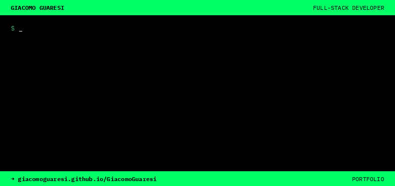
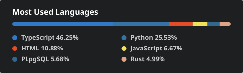
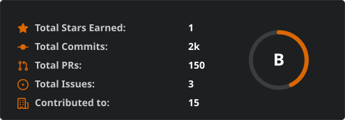

### [giacomoguaresi.github.io/GiacomoGuaresi](https://giacomoguaresi.github.io/GiacomoGuaresi)

---

## Full-Stack Developer

I build web applications for machines, plants and industrial data, end to end:
React and TypeScript front ends, Node.js and .NET back ends, PostgreSQL, Docker
and CI/CD. Eight years of software in production, from pharmaceutical plants to
an industrial 3D printer.

Based near Milan, Italy. Open to full-stack roles, hybrid or remote.

**Right now** I build and run the internal platform of a manufacturing startup,
as its only developer: around ten web applications in React, Node.js and
PostgreSQL — CRM, ERP, project management, production, warehouse, customer
support — used every day by everyone in the company, with an AI assistant built
in on Gemini function calling, plus the Linux servers, Docker deployments and
CI pipelines underneath. I also look after the software of the company's industrial 3D
printer and contribute upstream:
[eight pull requests merged into OrcaSlicer](https://github.com/OrcaSlicer/OrcaSlicer/pulls?q=is%3Apr+author%3AGiacomoGuaresi+is%3Amerged),
and one each into [Kalico](https://github.com/KalicoCrew/kalico/pull/840) (the
Klipper fork), [MainsailOS](https://github.com/mainsail-crew/MainsailOS/pull/318)
and [KlipperScreen](https://github.com/KlipperScreen/KlipperScreen/pull/1578).

**Before that**: full-stack consulting on enterprise React, Angular and
TypeScript applications over cloud-native back ends; four years of software for
Italian pharmaceutical plants — a .NET portal, mobile apps and near-terabyte
databases under GMP; and a Spring and PostgreSQL portal for an IoT product.

## On my own time

- [FAInder](https://github.com/GiacomoGuaresi/FAInder) — a React Native / Expo
  app in TypeScript for exploring Italy's FAI heritage sites on a map, with
  check-ins and a nightly data refresh on GitHub Actions.
- [Grocery](https://github.com/GiacomoGuaresi/Grocery) and
  [Projects](https://github.com/GiacomoGuaresi/Projects) — two PWAs in React,
  TypeScript and Supabase, real-time and offline, with Vitest suites, written
  architecture and decision records, and automated deploys.
- [Piccola Guida per Campeggiatori](https://giacomoguaresi.github.io/PiccolaGuidaPerCampeggiatori/)
  — pocket cheat sheets for the outdoors, a no-build offline PWA that prints to A5.

## Stack

| | |
|---|---|
| **Core** | React · TypeScript · Node.js · C# / .NET · PostgreSQL · Docker · CI/CD (GitHub Actions, GitLab CI) · Linux servers, production deploys |
| **Also shipped with** | Angular · Python · Java / Spring · C / C++ · Kubernetes (as a user of managed clusters) · Kafka · Redis pub/sub · MongoDB · OAuth · Microservices and event-driven services · LLM integration with function calling · Supabase |
| **Industrial & IoT** | Modbus · OPC-UA · MQTT · CAN bus · SCADA (iFIX, Movicon) · ESP32 · STM32 · Embedded Linux · PCB design · 3D printing (Klipper, OrcaSlicer) |

**Learning now:** Rust · agentic AI systems

## GitHub

  
    
  

